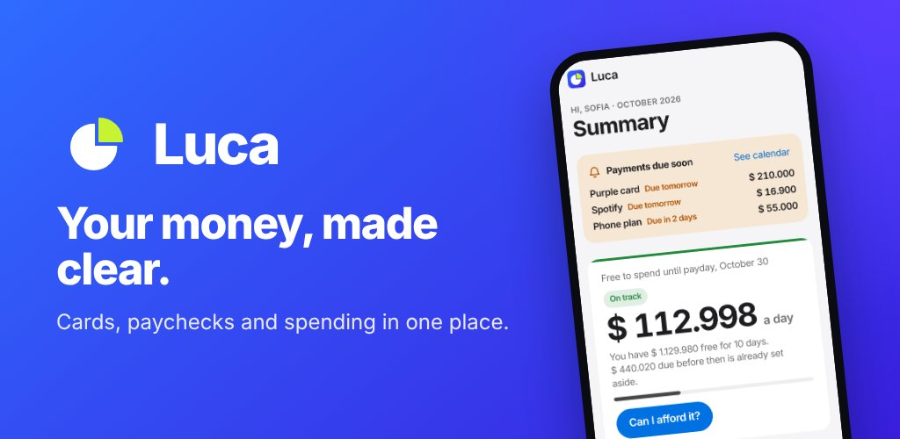
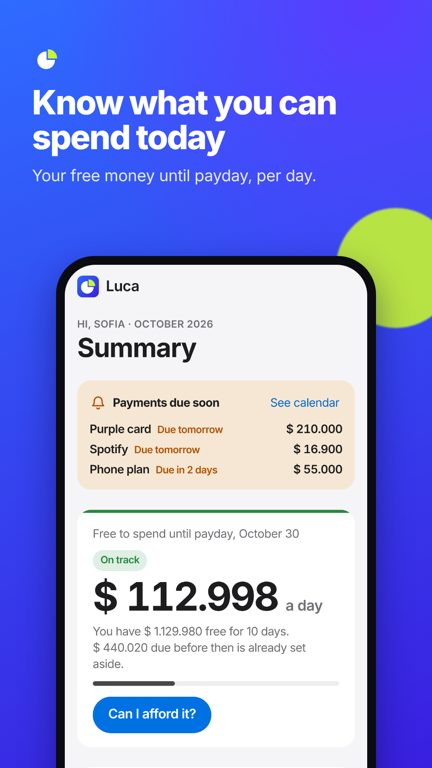
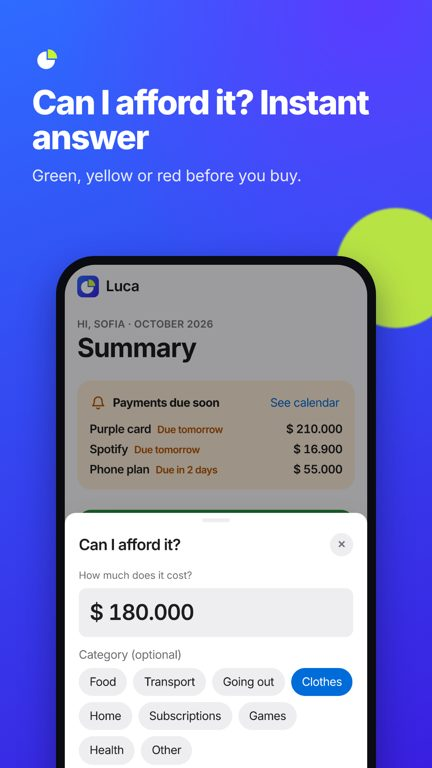
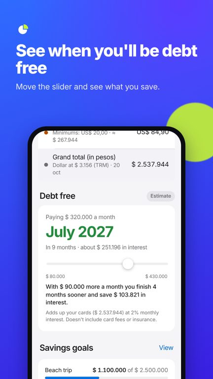
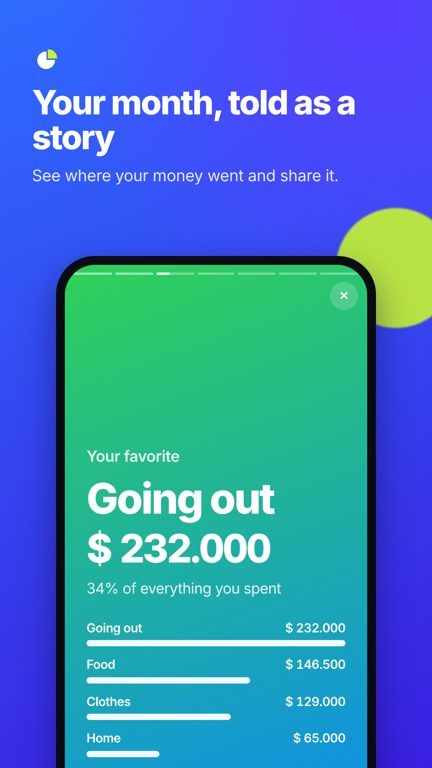
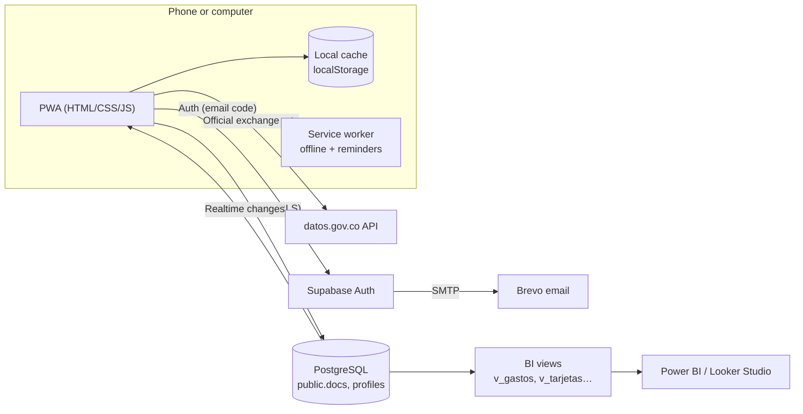

<p align="center"></p>

<h1 align="center">Luca</h1>
<p align="center"><b>A personal-finance app built for how Colombians actually get paid: twice a month, with credit cards in pesos <i>and</i> dollars.</b></p>
<p align="center">
  <a href="https://andresr-7.github.io/luca/">Live app</a> ·
  <a href="https://andresr-7.github.io/luca/descargas/Luca.apk">Android APK</a> ·
  <a href="docs/SETUP.es.md">Setup guide (ES)</a> ·
  
</p>

---

## The problem

Most budgeting apps assume a monthly salary and a single currency. In Colombia many people are paid on the **15th and 30th**, juggle **several credit cards** whose minimum payments land on different days, and carry **dollar-denominated debt** that changes with the exchange rate. The question they ask every day is simple — *"how much can I spend today without being short before payday?"* — and no app answered it.

I built Luca to answer that question for my own finances, then turned it into a product: accounts, a real database, an installable app and an Android package ready for Google Play.

## What it does

| | |
|---|---|
|  | **Free until payday.** One big number: what you can spend per day until your next paycheck, after setting aside every card minimum and fixed bill due before then.<br><br>**Daily rings & streak.** Apple-Activity-style rings for today, the month and card payments, plus a streak of days within budget. |
|  | **"Can I afford it?"** Type a price, get a green / yellow / red answer that considers your pace, upcoming bills and category budget.<br><br>**Type expenses like you talk.** `lunch 18k wallet`, `uber 12.500 nubank yesterday`, `netflix 20 usd amex` — a rule-based parser extracts amount (incl. Colombian slang like *lucas* and *palos*), currency, account/card, date and category. |
|  | **Debt-free date.** Amortization simulation per card with its own monthly interest rate; a slider shows how much sooner you finish (and how much interest you save) by paying more.<br><br>**Smart payment plan.** Splits a monthly budget across cards with the *avalanche* or *snowball* strategy and compares it against minimum-only payments. |
|  | **Your month as a story.** An animated, shareable recap: total spent, top category, busiest day, biggest purchase.<br><br>Also: subscription hunter, paycheck splitter, small-leak ("gasto hormiga") insights, payment reminders with an `.ics` calendar export, savings goals, CSV export, privacy mode, dark mode, Spanish/English. |

## Tech stack

| Layer | Choice | Why |
|---|---|---|
| UI | Vanilla HTML, CSS and JavaScript (no framework, no build step) | Fast on low-end Android phones, ~50 KB of app code, trivial to deploy |
| Design | Custom iOS-style design system (tokens, grouped lists, sheets, spring animations), Inter + SF | Feels native when installed |
| Data & auth | **Supabase** (PostgreSQL, Row Level Security, Auth, Realtime) | Real relational database with per-user security and live sync across devices |
| Email | Brevo SMTP for 6-digit sign-in / recovery codes | Free tier, custom templates |
| Hosting | GitHub Pages + Service Worker (offline-first PWA) | Free, HTTPS, installable |
| Android | Trusted Web Activity built with Bubblewrap/PWABuilder, Digital Asset Links | Same codebase ships to Google Play |
| Testing | Playwright end-to-end tests against a mocked Supabase client, GitHub Actions CI | 50+ checks on every push |

## Architecture



## Data model

```sql
-- One row per record, owned by a user. Row Level Security: auth.uid() = user_id.
create table public.docs (
  user_id    uuid references auth.users on delete cascade,
  collection text,          -- 'tarjetas' | 'gastos' | 'pagos' | 'ingresos' | 'cuentas' | 'movcuentas' | 'metas' | 'ajustes'
  id         text,
  data       jsonb,
  updated_at timestamptz default now(),
  primary key (user_id, collection, id)
);
create table public.profiles (id uuid primary key references auth.users, plan text default 'free', plan_until timestamptz, rol text);
```

**Design decisions**
- **Document rows + typed views.** The app writes flexible JSON documents (fast iteration, offline merge, no migrations for new fields), while SQL views (`v_gastos`, `v_tarjetas`, `v_pagos_tarjetas`, …) expose typed columns for analytics. See [`supabase/schema.sql`](supabase/schema.sql).
- **Security in the database, not the client.** The public anon key is safe to ship because RLS restricts every row to its owner; plan and role live in `profiles`, which users can read but never update.
- **Optimistic UI.** Writes update local state immediately, then sync; Realtime pushes changes from other devices.
- **Account deletion** runs through a `security definer` function, as required by Google Play.

## Run it locally

```bash
git clone https://github.com/Andresr-7/luca.git && cd luca
npm install
npm run serve        # http://localhost:5173
npm test             # syntax checks + Playwright end-to-end tests (mocked backend)
```

To use your own backend, create a Supabase project, run `supabase/schema.sql` and put your URL and anon key in `config.js`. Full step-by-step guide (Spanish): [`docs/SETUP.es.md`](docs/SETUP.es.md).

## Project structure

```
index.html      app shell and screens          pro.js        rings, insights, payment plan, paycheck split
styles.css      iOS-style design system         i18n*.js      translation layer + English dictionary
app.js          data layer, auth, core screens  sw.js         offline cache and background reminders
extras.js       free-until-payday, parser,      supabase/     schema, RLS, views, payment webhook
                reminders, debt simulator       tests/        Playwright end-to-end suite
```

## Roadmap
- Google Play release (closed testing in progress)
- Google Play Billing for Luca Pro
- Apple Pay shortcut and bank-statement import
- Colombian Open Finance integration once the SFC standards are live

## License
MIT
